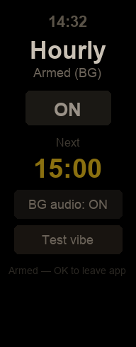
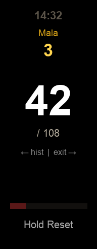
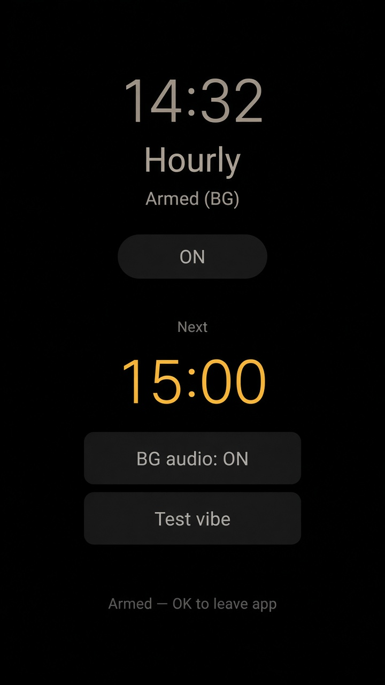
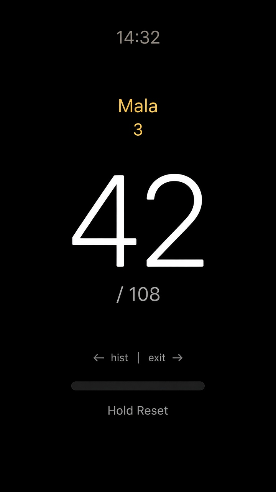

# Band 9 Quick Apps

Sideloadable **Xiaomi Smart Band 9** Vela JS quick apps (debug `.rpk`):

| App | Package | Version | What it does |
|-----|---------|---------|--------------|
| **Hourly** | `com.hourly.vibe` | 1.1.0 | ~2s vibration on each clock hour (`:00`) — **no snooze / no 10‑minute Later loop** |
| **Japa** | `com.japa.counter` | 1.5.4 | Tap-only mala counter: 108 beads → 1 mala, soft haptic per bead, hold-to-reset |

Prebuilt packages live in [`releases/`](./releases/). Source for each app is under `hourly-vibe/` and `japa-counter/`.

Target capsule: **192×490** (`designWidth` 96).

---

## Screenshots

### Hourly

<p align="center">
  
</p>

- Clock at the top
- **ON / OFF** arm toggle
- **Next** fire time
- **BG audio** keepalive (lets you leave to the watchface)
- **Test vibe** for an immediate ~2s haptic

### Japa

<p align="center">
  
</p>

- Clock at the top
- **Mala** count + large **bead** count (`/ 108`)
- Tap the main area to +1 bead
- Swipe ← for history, swipe → to exit
- **Hold Reset** ~4s (progress bar) → confirm Yes/No

Wider preview renders (same UI, not device photos):

| Hourly | Japa |
|--------|------|
|  |  |

> Screenshots are UI mockups matching the shipped layout (Band 9 192×490). They are **not** photographs of a physical band.

---

## Quick install (prebuilt `.rpk`)

1. Download from [`releases/`](./releases/):
   - [`com.hourly.vibe.debug.1.1.0.rpk`](./releases/com.hourly.vibe.debug.1.1.0.rpk)
   - [`com.japa.counter.debug.1.5.4.rpk`](./releases/com.japa.counter.debug.1.5.4.rpk)
2. Install with **AstroBox** (detailed steps below).
3. On the band: open the app list → **Hourly** or **Japa**.

These are **debug** builds. Do not use a release/signed store package unless you know what you are doing.

---

## Install with AstroBox (recommended — detailed)

Official docs:

- Downloads: [https://astrobox.online/en/downloads](https://astrobox.online/en/downloads)
- Install guide: [https://abox.run/docs/usage/install](https://abox.run/docs/usage/install)
- Local resource install: [https://abox.run/docs/usage/resource](https://abox.run/docs/usage/resource)

Band 9 is listed as **full support** on AstroBox.

### A. Get AstroBox on your phone / computer

#### iPhone / iPad (primary path used for these apps)

1. Uninstall AstroBox **V1** if present (V1 + V2 together cause problems).
2. Install **AstroBox** from the **App Store** (AstroBox no longer recommends sideloaded IPAs).
3. Open the app and complete first-run (OOBE): account login, permissions, etc.
4. Follow current system requirements on the [install docs](https://abox.run/docs/usage/install) — AstroBox documents a recent iOS baseline; if the App Store listing won’t install, update iOS first.

**iOS Bluetooth tip:** iOS locks the band’s BLE link to one app. Before connecting in AstroBox:

1. Open **Settings → Bluetooth**.
2. Find the Band 9 entry → **Forget This Device**.
3. Force-quit **Mi Fitness** / 小米运动健康 (swipe away from app switcher).
4. Then connect from AstroBox.

If you reopen Mi Fitness later, you may need to forget the device again before AstroBox can reclaim the link.

#### Android (included for completeness — **not tested** for these packages)

> **Not tested.** The `.rpk` files and install flow below were exercised on the Band 9 via the AstroBox path used for MACW-11 / MACW-12 work. Android AstroBox should work the same for local RPK push, but this repo does **not** claim a verified Android install of these specific builds.

1. Uninstall AstroBox V1 if present.
2. Download AstroBox Android from [astrobox.online downloads](https://astrobox.online/en/downloads) (Android 10+; docs recommend a newer Android for best results). Prefer the **built-in WebView** APK if your phone is older or the normal build crashes on Xiaomi login.
3. Install the APK (allow install from that source in system settings if prompted).
4. On first launch, grant **all** requested permissions, especially:
   - **Location → Precise / Exact**
   - **Bluetooth → Allow always / while using**
   - **Nearby devices** (check App info → Permissions manually if missing)
5. On some Xiaomi phones, turn **Developer options OFF** if AstroBox cannot scan the band.
6. Complete OOBE / account login.

#### Desktop (optional)

macOS / Windows / Linux builds are also on the downloads page. Desktop can connect over Bluetooth and push local RPKs (drag-and-drop on desktop). Useful if phone BLE is flaky.

### B. Connect Band 9

1. On the band, put it in **connect new phone** mode (wording varies by firmware; typically under Settings → system / device → connect new phone).
2. In AstroBox, open the **device** page and select / pair your Band 9.
3. Prefer **Xiaomi account login** so AstroBox can import the device and AuthKey automatically.
   - Or enter **AuthKey** manually if you already have it from a previous bind.
4. Confirm pairing on the band when prompted.
5. Wait until AstroBox shows the device as **connected**.

If connection fails (GATT 133 / disconnect loops):

- Force-stop **Mi Fitness** again
- Toggle phone Bluetooth off/on
- Forget the band in system Bluetooth (especially on iOS)
- Retry pair from AstroBox

### C. Push a local `.rpk` (quick app)

You need the `.rpk` file on the same device that runs AstroBox (AirDrop / Files / Downloads / USB).

AstroBox supports local install three ways ([docs](https://abox.run/docs/usage/resource)):

#### Option 1 — Device page (phone)

1. Open the **device** card / device info page (connected state).
2. Enter the **quick app / application** resource type (the card for apps, not watchfaces).
3. Tap **+** (top right) → pick `com.hourly.vibe.debug.1.1.0.rpk` or `com.japa.counter.debug.1.5.4.rpk`.
4. If auto-install is disabled: open the **queue** (list icon near Settings / beside the device capsule) → tap **Start**.
5. Wait for the push to finish; the band may briefly show install progress.

#### Option 2 — Queue page

1. Open the **queue**.
2. Tap **+** → choose resource type **quick app / application**.
3. Select the `.rpk` → start the queue if needed.

#### Option 3 — Desktop drag-and-drop

1. Connect Band 9 in desktop AstroBox.
2. Drag the `.rpk` onto the AstroBox window.
3. Start the queue if auto-install is off.

### D. Open on the band

1. On Band 9: app list → **Hourly** or **Japa**.
2. For **Hourly**: leave **ON** + **BG audio: ON**, confirm status like **Armed (BG)**, then you can return to the watchface. Use **Test vibe** once.
3. For **Japa**: tap the center to count; hold **Reset** to clear.

### E. Updating a later build

Bump fails silently sometimes. Rebuild with a higher `versionCode` / `versionName` in `src/manifest.json`, or install the newer file from `releases/`. If the band keeps the old UI, uninstall the quick app from AstroBox’s device app list (if available) and reinstall.

---

## App notes

### Hourly (v1.1.0)

| Event | Behavior |
|-------|----------|
| `:00` | ~2s haptic (5× `long` pulses), then stop |
| After fire | No snooze / no Later / no 10‑minute re-fire |
| Ignore | Quiet until the next hour |

**BG audio:** Vela only keeps quick apps alive after leave via limited background features (`system.audio` here). Hourly plays a muted looping keepalive so the scheduler in `app.ux` can survive leaving to the watchface. This is **not** a guaranteed OS daemon; battery cost is higher while BG audio runs. If status shows **Audio BG failed**, use a phone notification path instead of a stock band alarm (see `hourly-vibe/INSTALL.md`).

### Japa (v1.5.4)

| Control | Behavior |
|---------|----------|
| Primary tap | Beads +1, soft haptic |
| 108th tap | Flash 108 → heavier haptic → mala +1 → beads 0 |
| Hold Reset | ~4s fill → Yes/No confirm → clears beads + mala |
| Persistence | Counts saved across reopen |

---

## Rebuild from source

Requires Node.js (8.10+; modern Node is fine) and network for `aiot-toolkit`.

```bash
# Hourly
cd hourly-vibe
npm install
npm run build
# → dist/com.hourly.vibe.debug.<version>.rpk

# Japa
cd ../japa-counter
npm install
npm run build
# → dist/com.japa.counter.debug.<version>.rpk
```

Use `npm run build` (debug). `npm run release` produces a signed package that typically will **not** sideload the same way.

---

## Troubleshooting

| Symptom | Fix |
|---------|-----|
| Won’t connect / GATT 133 | Force-stop Mi Fitness; forget Bluetooth device (iOS); retry AstroBox |
| AstroBox can’t see band | Precise location + nearby devices (Android); connect-new-phone mode on band |
| Install / cert rejected | Use the **debug** `.rpk` from this repo / `npm run build` |
| Update doesn’t appear | Bump `versionCode` / reinstall |
| Hourly stops after leaving app | Confirm **BG audio: ON** and Armed (BG); otherwise use phone notification fallback |
| Band too dim after Japa | Newer builds restore system brightness on show/hide; reopen Japa once |

---

## License / disclaimer

Personal / experimental sideload tools for Band 9. Not affiliated with Xiaomi. Not published to Mi Fitness store. Use at your own risk; debug packages are for development sideload only.
